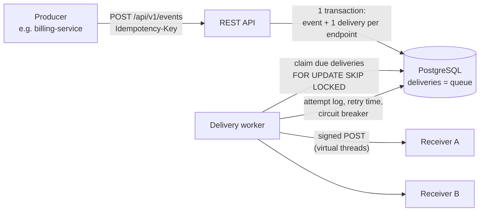
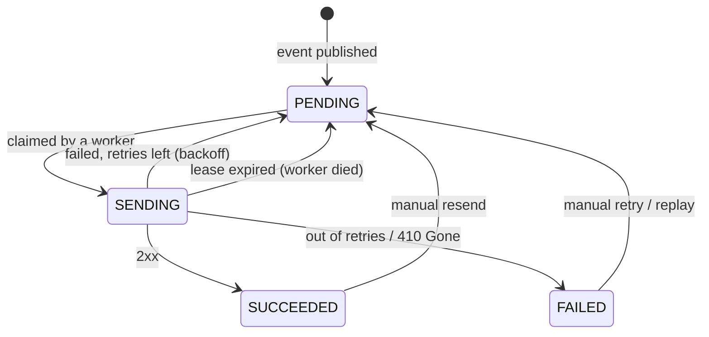

# webhook-delivery-service

[](https://github.com/smileyDDx1/webhook-delivery-service/actions/workflows/ci.yml)

A service that delivers webhooks reliably. Your systems publish an event once (`invoice.paid`), and the service signs it, sends it to every endpoint that subscribed, retries failures with exponential backoff, pauses endpoints that keep failing, and keeps a log of every attempt so failed deliveries can be found and sent again.

Built with **Java 21, Spring Boot 4.1 and PostgreSQL**. Payment and SaaS companies (Stripe, GitHub, Razorpay, Shopify) run services like this to send their webhooks; this is a small version of one.

I built it to learn what has to happen after a plain `httpClient.post()` before anyone can rely on it: retries without hammering the receiver, signatures, idempotency, several workers sharing one queue, and testing all of that against a real database.

## Features

- **Publish once, fan out**: one event goes to every subscribed endpoint, filtered by event type (`invoice.paid`, `invoice.*`, `*`)
- **Signed requests**: HMAC-SHA256 in the [Standard Webhooks](https://www.standardwebhooks.com) format, with timestamps against replay attacks and **secret rotation** without downtime
- **Retries** with exponential backoff + jitter, `Retry-After` support, `410 Gone` disables the endpoint
- **Circuit breaker** per endpoint: after 10 failures in a row the endpoint is paused instead of hammered
- **Failed deliveries (dead letters)** can be listed, retried one by one, or replayed per endpoint after an outage
- **Idempotency keys**: a producer can safely retry `POST /events`; duplicates return the original event
- **Several workers, no double sends**: deliveries are claimed with `SELECT ... FOR UPDATE SKIP LOCKED`, with a lease and a reaper for crashed workers
- **Virtual threads** (Java 21) for sending, with a cap on requests in flight
- **Multi-tenant**: every application has its own API key (stored as a SHA-256 hash) and only sees its own data
- **Rate limiting** per application (token bucket), **SSRF protection** for endpoint URLs
- **Delivery log** with status code, duration and the start of the receiver's response for every attempt
- **Stats and metrics**: success rate and p95 latency per endpoint, Prometheus metrics at `/actuator/prometheus`
- **ProblemDetail (RFC 9457) errors**, OpenAPI docs with Swagger UI, Flyway migrations, Docker Compose, GitHub Actions CI

## Tech stack

| | |
|---|---|
| Language / framework | Java 21, Spring Boot 4.1 (Spring MVC, Spring Data JPA, Spring Security, Validation, Actuator) |
| Database | PostgreSQL 16, Flyway migrations, Hibernate 7 + `JdbcClient` for the queue queries |
| HTTP client | JDK `java.net.http.HttpClient` on virtual threads |
| API docs | springdoc-openapi 3 (Swagger UI) |
| Metrics | Micrometer + Prometheus registry |
| Testing | JUnit 6, Mockito, AssertJ, Testcontainers 2, WireMock 3, Rest Assured 6, Awaitility, JaCoCo |
| DevOps | Docker (multi-stage, non-root), Docker Compose, GitHub Actions |

## How it works



1. `POST /api/v1/events` stores the event and one `PENDING` delivery per subscribed endpoint **in the same transaction**, and answers `202 Accepted`. Nothing is sent during the request.
2. The worker polls every 500 ms. It claims due deliveries and marks them `SENDING` with a 60 second lease, in one SQL statement. `SKIP LOCKED` lets several workers (or app instances) poll at the same time without claiming the same delivery.
3. Each delivery is sent on its own virtual thread, **without** a database transaction open (a slow receiver must not hold a pooled connection).
4. The result is saved in a short transaction: an attempt row, then `SUCCEEDED`, a retry at `next_attempt_at`, or `FAILED`.
5. A reaper puts `SENDING` deliveries with an expired lease back in the queue (the worker crashed mid-request). Delivery is therefore **at least once**, and receivers should de-duplicate on `webhook-id`.

### Delivery lifecycle



### Retry schedule

Default: 8 attempts, delays grow 4x, +/- 20% jitter. A receiver can be down for about 6 hours before a delivery is marked `FAILED`.

| After attempt | 1 | 2 | 3 | 4 | 5 | 6 | 7 |
|---|---|---|---|---|---|---|---|
| Wait | 5 s | 20 s | 1 min 20 s | 5 min 20 s | 21 min | 1 h 25 min | 4 h (cap) |

If the receiver answers `429` or `503` with `Retry-After`, that wait is used instead (up to 1 hour). Independently, the **circuit breaker** pauses an endpoint for 5 minutes after 10 failures in a row; its waiting deliveries are moved to the end of the pause so they don't use up their attempts.

Design decisions and trade-offs are explained in [docs/questions-answers.md](docs/questions-answers.md).

## API

All endpoints need `Authorization: Bearer <key>`. Full docs in Swagger UI at `/swagger-ui.html`.

| Method | Path | Key | What it does |
|---|---|---|---|
| POST | `/api/v1/admin/applications` | admin | Create an application, returns its API key (shown once) |
| GET | `/api/v1/admin/applications` | admin | List applications |
| GET | `/api/v1/admin/applications/{id}` | admin | One application |
| POST | `/api/v1/admin/applications/{id}/api-key/rotate` | admin | New API key, the old one stops working |
| DELETE | `/api/v1/admin/applications/{id}` | admin | Delete with all its data |
| POST | `/api/v1/endpoints` | app | Register an endpoint (url, description, eventTypes) |
| GET | `/api/v1/endpoints` | app | List endpoints |
| GET / PUT / DELETE | `/api/v1/endpoints/{id}` | app | Read, update, delete one |
| GET | `/api/v1/endpoints/{id}/secret` | app | Signing secret |
| POST | `/api/v1/endpoints/{id}/secret/rotate` | app | New secret, old one keeps signing for 24 h |
| POST | `/api/v1/endpoints/{id}/disable` | app | Stop sending, waiting deliveries become `FAILED` |
| POST | `/api/v1/endpoints/{id}/enable` | app | Turn back on, reset the circuit breaker |
| POST | `/api/v1/endpoints/{id}/replay-failed` | app | Queue all `FAILED` deliveries of the endpoint again |
| GET | `/api/v1/endpoints/{id}/stats` | app | Deliveries by status, success rate and p95 latency (24 h) |
| POST | `/api/v1/events` | app | Publish an event (`Idempotency-Key` header optional) |
| GET | `/api/v1/events` | app | List events (filter by `eventType`, `from`, `to`) |
| GET | `/api/v1/events/{id}` | app | Event payload + status of each delivery |
| GET | `/api/v1/deliveries` | app | List deliveries (filter by `status`, `endpointId`, `eventId`) |
| GET | `/api/v1/deliveries/{id}` | app | One delivery |
| GET | `/api/v1/deliveries/{id}/attempts` | app | Attempt log |
| POST | `/api/v1/deliveries/{id}/retry` | app | Send again with a fresh set of retries |
| GET | `/api/v1/stats` | app | Totals for the application |
| GET | `/actuator/health` | none | Health, liveness and readiness |
| GET | `/actuator/prometheus` | admin | Metrics |

### Publishing an event

```bash
curl -X POST http://localhost:8080/api/v1/events \
  -H "Authorization: Bearer whk_..." -H "Content-Type: application/json" \
  -H "Idempotency-Key: invoice-42-paid" \
  -d '{"eventType": "invoice.paid", "payload": {"invoiceId": "inv_42", "amountCents": 4999}}'
```

```json
{"id": 42, "webhookId": "evt_42", "eventType": "invoice.paid", "createdAt": "2026-11-13T10:15:30Z", "deliveryCount": 2}
```

Sending the same request again returns `200` with `Idempotent-Replayed: true` and the same event. The same key with a different payload returns `409`.

### What a receiver gets

```http
POST /webhooks HTTP/1.1
Content-Type: application/json
webhook-id: evt_42
webhook-timestamp: 1794564930
webhook-signature: v1,<base64 of HMAC-SHA256(secret, "evt_42.1794564930." + body)>

{"id":"evt_42","type":"invoice.paid","timestamp":"2026-11-13T10:15:30Z","data":{"invoiceId":"inv_42","amountCents":4999}}
```

`webhook-id` stays the same on every retry, so the receiver can ignore duplicates.

### Verifying signatures (receiver side)

```java
// signedContent = webhook-id + "." + webhook-timestamp + "." + raw body
Mac mac = Mac.getInstance("HmacSHA256");
mac.init(new SecretKeySpec(Base64.getDecoder().decode(secret.substring("whsec_".length())), "HmacSHA256"));
String expected = "v1," + Base64.getEncoder().encodeToString(
        mac.doFinal((webhookId + "." + timestamp + "." + body).getBytes(UTF_8)));

// 1. reject timestamps older than 5 minutes (replay protection)
// 2. compare with MessageDigest.isEqual (constant time), against each space-separated signature
```

The full version is [`WebhookVerifier`](src/main/java/com/debangshu/webhooks/signing/WebhookVerifier.java). Because the format follows Standard Webhooks, the official libraries for Node, Python, Go etc. work too.

### Errors

Every error is `application/problem+json`:

```json
{
  "type": "about:blank",
  "title": "Validation failed",
  "status": 400,
  "detail": "One or more fields are invalid",
  "instance": "/api/v1/endpoints",
  "errors": {"url": "must not be blank"}
}
```

## Getting started

### Run with Docker (easiest)

Needs Docker only, no JDK.

```bash
docker compose up --build
```

- API: http://localhost:8080, Swagger UI: http://localhost:8080/swagger-ui.html
- Admin key: `local-admin-key-change-me` (set `ADMIN_API_KEY` to change it)
- `demo-receiver` on port 9090 is a pretend customer server with `/ok`, `/flaky`, `/slow`, `/down`, `/gone` and `/busy` URLs

Then run the demo, which creates an application and four endpoints, publishes events and shows what happened (retries, the circuit breaker pausing `/down`, `/gone` getting disabled):

```bash
./scripts/demo.sh
```

[requests.http](requests.http) has the same flow for the IntelliJ / VS Code HTTP client.

### Run locally (JDK 21)

```bash
docker compose up -d postgres
ADMIN_API_KEY=dev-key ALLOW_PRIVATE_URLS=true ./mvnw spring-boot:run
```

### Configuration

| Environment variable | Default | |
|---|---|---|
| `ADMIN_API_KEY` | (none, required) | Key for `/api/v1/admin/**` and `/actuator/**` |
| `DATABASE_URL` / `DATABASE_USERNAME` / `DATABASE_PASSWORD` | `jdbc:postgresql://localhost:5433/webhooks`, `webhooks`, `webhooks` | |
| `ALLOW_PRIVATE_URLS` | `false` | Allow endpoints on localhost / private networks (local development only) |
| `DELIVERY_WORKER_ENABLED` | `true` | Run the delivery worker in this instance |

Retry schedule, circuit breaker, timeouts and concurrency are under `app.delivery` in [application.yml](src/main/resources/application.yml).

## Testing

```bash
./mvnw verify            # unit tests + integration tests (needs Docker for Testcontainers)
./mvnw test              # unit tests only, no Docker
./mvnw verify -Pbenchmark  # the benchmarks below
```

**151 tests, all passing: 94 unit tests and 57 integration tests, with 94.4% line coverage and 81.4% branch coverage** (JaCoCo, unit and integration tests merged; CI uploads the HTML report).

| | Tests | What they check |
|---|---|---|
| Unit (`*Test`, no Spring, no Docker) | 94 | backoff math, signatures (including the Standard Webhooks test vector), SSRF rules, event type matching, token bucket with a fake clock, result handling with Mockito, the HTTP sender against WireMock (timeouts, redirects, Retry-After, huge responses) |
| Integration (`*IT`, real PostgreSQL in Testcontainers) | 57 | the API over HTTP with Rest Assured: auth, validation errors, tenant isolation, idempotency with 10 concurrent requests. The real worker delivering to WireMock: signature verified like a receiver would, retries, Retry-After, 410, circuit breaker, replay, secret rotation. Concurrency: 8 threads claiming 2,000 deliveries with no duplicates, 40 threads updating the failure counter with no lost updates |

The integration tests share one Spring context and one Postgres container, and use short retry delays (200 ms instead of 5 s) from [application-test.yml](src/test/resources/application-test.yml).

## Performance

Measured on my laptop (Intel i3-1115G4, everything inside Docker Desktop with 4 CPUs). Full tables, query plans and caveats: [docs/benchmark-results.md](docs/benchmark-results.md).

**The queue query on 1,000,000 deliveries** (the worker runs it every 500 ms; 99% of rows are finished):

| Index | Time | Index size |
|---|---|---|
| none for this query | 13.02 ms | - |
| partial `(next_attempt_at) WHERE status = 'PENDING'` (first version) | 11.71 ms | 240 kB |
| **partial `(status, next_attempt_at) WHERE status = 'PENDING'` (current)** | **0.18 ms** | **400 kB** |
| full `(status, next_attempt_at)` | 0.18 ms | 7,200 kB |

The first partial index barely helped because Postgres estimated 56 due rows instead of 5,275 and chose a bitmap scan + sort over all of them. With `status` first it reads the index in order and stops after 100 rows: **65x faster, and 18x smaller than a full index**.

**Delivery throughput** to a receiver that takes 100 ms per request (median of 3 runs):

| Max requests in flight | Deliveries/s | JVM threads |
|---|---|---|
| 1 | 6 | 48 |
| 50 (platform threads) | 80 | 114 |
| 200 (platform threads) | 123 | 274 |
| 200 (virtual threads) | 94 | 80 |

Going from 1 to 50 parallel requests gives 13x the throughput. Above that, my 2-core laptop (shared by Postgres, the app and the receiver) is the bottleneck and runs vary from 78 to 219 per second. What virtual threads changed consistently is the thread count: **80 instead of about 275** for the same 200 requests in flight.

## Project structure

```
src/main/java/com/debangshu/webhooks
├── application/   applications (tenants) and the admin API
├── endpoint/      endpoints, URL/SSRF validation, event type filters, circuit breaker
├── event/         publishing (idempotency, fan-out) and reading events
├── delivery/      the queue (SKIP LOCKED), worker, retry policy, results, delivery API
├── sending/       HTTP client, Retry-After parsing, payload envelope
├── signing/       HMAC signatures, secrets, verifier for receivers
├── ratelimit/     token bucket per application
├── stats/         stats queries
├── security/      API key filter and Spring Security config
├── common/        errors (ProblemDetail), paging
└── config/        typed configuration (records), clock, OpenAPI
src/main/resources/db/migration   Flyway SQL
demo-receiver/                    pretend customer server for the demo (plain JDK)
docs/                             Q&A, benchmarks, future plans
```

## What I learned

- **"Check, then insert" is a race condition.** My first idempotency check was `SELECT` by key and `INSERT` if not found; two requests at the same moment both inserted. `INSERT ... ON CONFLICT DO NOTHING` lets Postgres settle it, and a test now fires 10 identical requests at once.
- **A database table can be a decent queue.** `FOR UPDATE SKIP LOCKED` was new to me; with it, workers never wait for each other and never get the same row. I also learned to put the `SELECT ... FOR UPDATE` in a CTE so the `LIMIT` is applied exactly once.
- **An index existing doesn't mean it's used well.** My first partial index for the queue barely helped (11.7 ms vs 13 ms with no index). `EXPLAIN ANALYZE` showed Postgres estimating 56 due rows instead of 5,275 (it assumes columns are independent), so it read and sorted all of them. Putting `status` first fixed the plan (0.18 ms). I shipped it as a new Flyway migration (`V2`), because applied migrations must never change.
- **Read-modify-write through JPA loses updates under concurrency.** The endpoint failure counter has to be `SET x = x + 1` in SQL. I also marked those columns `updatable = false` so a normal JPA save can't write an old value back.
- **Don't hold a transaction across an HTTP call.** The worker loads, sends with no connection held, then saves. Otherwise a few slow receivers would use up the connection pool.
- **Optimistic locking (`@Version`) fits rare conflicts, pessimistic locking (`SKIP LOCKED`) fits constant competition.** This project needed both.
- **Virtual threads make blocking code cheap, but not limitless or faster.** I still need a semaphore, or a backlog after an outage would open thousands of connections at once. And in the benchmark they cut the thread count from about 275 to 80 but didn't add throughput, because the limit was CPU and the database, not threads.
- **Benchmarks on a laptop are noisy.** The same 200-in-flight test gave 78 to 219 deliveries per second across runs, so I report medians of 3 runs and every run's number, and only claim the differences that are bigger than the noise.
- **Spring Boot 4 changed more than I expected.** Jackson 3 moved to `tools.jackson`, Flyway needs `spring-boot-starter-flyway`, `spring-boot-starter-web` is now `spring-boot-starter-webmvc`, and Testcontainers 2 moved `PostgreSQLContainer` to a new package.
- **Testing async code**: Awaitility instead of `Thread.sleep`, WireMock scenarios for "fail twice, then succeed", and very short retry delays in the test profile. One test was flaky because the very first HTTP request in the JVM is slow (class loading), so it now warms up first.
- **N+1 queries sneak in through `map()`.** The event list called `countByEventId` per row; one `GROUP BY` query fixed it.
- **A circuit breaker isn't perfectly strict**: requests already in flight when it opens still go out. That's normal, but the test has to allow for it.

## Known limitations

- **At least once, not exactly once.** A worker that dies after sending but before saving the result causes a second delivery with the same `webhook-id`. Receivers need to de-duplicate.
- **No ordering guarantee.** A retry of event 1 can arrive after event 2.
- **Rate limits are per instance** (in-memory token buckets), so 3 instances allow 3x the limit.
- **The SSRF check runs when the endpoint is saved**, not on every connection, so DNS rebinding could get around it.
- **Tables grow forever**: there is no retention job yet for old events and attempts.
- **Numbers in the Performance section come from my laptop**, inside Docker Desktop, not from a production server.

More in [docs/future-plans.md](docs/future-plans.md).
